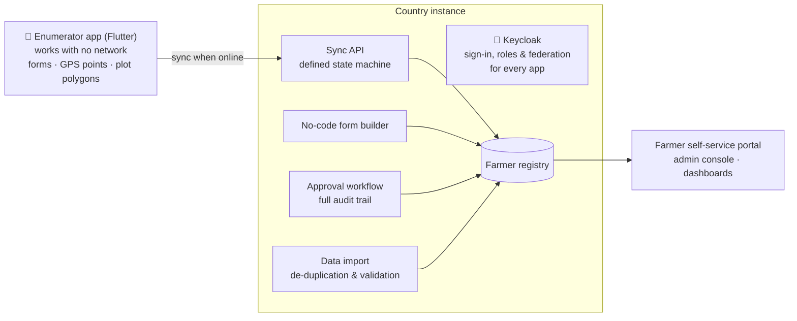

<!-- Ones & Zeros (Pvt) Ltd — organisation profile. Lives at Ones-Zeros/.github → profile/README.md -->

  <picture>
    <source media="(prefers-color-scheme: dark)" srcset="https://raw.githubusercontent.com/Ones-Zeros/.github/main/profile/assets/logo-dark-bg.png" />
    
  </picture>

<h3 align="center">Digital public infrastructure for agriculture and government services</h3>

  National registries, benefit management systems and the interoperability layers that connect them. 
  In production with the Food and Agriculture Organization of the United Nations across five countries.

  
  
  

  🇱🇰 Sri Lanka &nbsp;·&nbsp; 🇹🇴 Tonga &nbsp;·&nbsp; 🇨🇰 Cook Islands &nbsp;·&nbsp; 🇸🇧 Solomon Islands &nbsp;·&nbsp; 🇻🇺 Vanuatu

  <a href="#track-record">Track record</a> &nbsp;·&nbsp;
  <a href="#flagship-platform-digital-farmer-registry">Digital Farmer Registry</a> &nbsp;·&nbsp;
  <a href="#programme-portfolio">Portfolio</a> &nbsp;·&nbsp;
  <a href="#how-we-build">How we build</a> &nbsp;·&nbsp;
  <a href="#working-with-us">Work with us</a>

## What we actually do

Most software companies describe what they *can* build. This page describes what we have **built, tested with government users, and handed over**.

We design and operate the systems that let a government answer three questions with authority:

> **Who are our farmers? What do they produce? Who has already received which benefit?**

That means registries that hold identity, mobile applications that work where there is no network, API gateways that let other institutions use the data without copying it, and the migration and training work that gets a real institution onto the system.

We work almost entirely on donor-funded and public-sector programmes. There the bar is acceptance testing with real officers, a documented handover, and a system that still runs after the consultants leave.

## Track record

<table>
  <tr>
    <td align="center" width="25%"><h2>5</h2>countries in production</td>
    <td align="center" width="25%"><h2>7</h2>government &amp; institutional systems delivered</td>
    <td align="center" width="25%"><h2>4</h2>national registries on one shared codebase</td>
    <td align="center" width="25%"><h2>13+</h2>years of technical leadership</td>
  </tr>
</table>

- **Primary client:** Food and Agriculture Organization of the United Nations: FAO Sri Lanka &amp; Maldives, and the FAO Subregional Office for the Pacific
- **Sri Lankan institutions:** Department of Agriculture · Department of Export Agriculture · Department of Cinnamon Development
- **Core team:** 7 permanent engineers; senior engineers with 10+ years' experience
- **Delivery model:** fixed-scope milestones · UAT sign-off · train-the-trainer handover · source code and documentation transferred to the client

## Flagship platform: Digital Farmer Registry

A multi-country farmer registration and management platform built for FAO and deployed for **Tonga, the Cook Islands, the Solomon Islands and Vanuatu** under one programme. Each country runs its own instance, with its own branding, languages, administrative hierarchy and form catalogue, on one shared codebase.

| Capability | What it gives the ministry |
|---|---|
| **Offline-first enumerator app** | Officers download an assignment, register farmers, fill in forms, capture GPS points and draw plot polygons with no connection, then synchronise. Includes a review-and-approve chain and on-device diagnostics. |
| **No-code form builder** | Ministries change their own registration forms on a design canvas, without a software release. |
| **Identity and access (Keycloak)** | Role-based access control, ready for identity federation. |
| **Approval workflow engine** | Submission review, multi-level approval, and an audit trail on every record. |
| **Unified data import** | Migration of legacy registries with de-duplication and validation. |
| **Portal, console and dashboards** | Farmer self-service, administration, and reporting over the registry. |

Every country instance passed **user acceptance testing run by national ministry staff**, with test evidence, defect tracking and formal sign-off before going live. Each was handed over with train-the-trainer programmes for administrators, enumerators and farmers.

### On the way to becoming a Digital Public Good

We are preparing the DFR codebase for recognition as a **Digital Public Good**, under the FAO Digital Assets Management Standard and the DPG Standard.

- [x] **Milestone 1 of 4: security and compliance assessment.** OWASP Dependency-Check on the Spring backend, `npm audit` on the Next.js frontend and MobSF static analysis on the Flutter Android release, with a gap analysis and a dated, resourced remediation plan presented to the FAO Digital Empowerment team.
- [ ] Milestones 2–4: remediation and open-source release, targeted for the **Pacific Region Digital Agriculture Forum, Solomon Islands, 1–6 November 2026**.

For adopting governments this means no licence cost, no vendor lock-in, an OSI-approved licence, and a codebase that improves with every country that joins.

## Programme portfolio

| Programme | Client | What it does |
|---|---|---|
| 🌾 **CROPIX** · national e-Agriculture platform | FAO Sri Lanka · Department of Agriculture | Crop registry, operational workflows, seed certification, field data collection and decision support, with an admin web system and connected mobile apps for officers and farmers. |
| 🔗 **Sector API Gateway and Interoperability Layer** | FAO Sri Lanka · Department of Agriculture | Lets sector institutions use authoritative registry data through governed APIs instead of keeping their own copies, following the registry-based model in the Sri Lanka Government Agriculture Enterprise Architecture. |
| ✅ **GAP Certification Management System** | Department of Agriculture · Department of Export Agriculture · Department of Cinnamon Development | The Good Agricultural Practices certification lifecycle: application, inspection, audit, certificate issue and renewal. It stands between a smallholder and access to export markets. |
| 📊 **Project Activity Reporting &amp; Decision Support** | FAO | Programme monitoring, activity reporting and management decision support, proven at a UN agency in two countries and domain-agnostic by design. |
| 🧑‍🌾 **Agri-Advisory Platform** | — | Digital extension and advisory services, connected to the registry so advice reaches the right farmer on the right plot. |
| 🏥 **Beyond agriculture** | Sri Lanka College of Oncologists, and others | Institutional and enterprise systems, alongside 20+ commercial web and mobile engagements. |

## How we build

What decides whether a public-sector system survives its first year:

<table>
  <tr>
    <td width="50%" valign="top"><b>📡 Offline-first, not offline-tolerant</b> Field officers work where there is no connectivity. Synchronisation is designed as a state machine, not retried as an afterthought.</td>
    <td width="50%" valign="top"><b>🗂️ Registry-based architecture</b> One authoritative source per data domain, exposed through a gateway. No shadow copies, so no reconciliation problem later.</td>
  </tr>
  <tr>
    <td valign="top"><b>📜 Policy enforced as code</b> Data-sharing rules are checked at the gateway on every request and written to an immutable audit record, not left in a document nobody can enforce.</td>
    <td valign="top"><b>🛡️ Continuous security</b> Dependency, package and mobile static analysis run in CI. A Spring, Next.js, Flutter and Android stack does not stay compliant on its own.</td>
  </tr>
  <tr>
    <td valign="top"><b>🧭 Traceable to every requirement</b> Each clause of the specification maps to the part of the deliverable that answers it, so the client can verify coverage directly.</td>
    <td valign="top"><b>🤝 Handover is a deliverable</b> Source code, deployment artefacts, documentation and role-specific training. The client never depends on us to continue the work.</td>
  </tr>
</table>

### Standards and interoperability

Designed for national data exchange and identity federation from the start, not retrofitted when the mandate arrives.

  
  
  
  
  
  

### Engineering stack

| Layer | Technology |
|---|---|
| **Backend** |    |
| **Web** |    |
| **Mobile** |   |
| **Data &amp; geospatial** |    |
| **Identity &amp; security** |    |
| **Platform &amp; delivery** |       |

## Working with us

We take on assignments where the schedule is fixed and the system has to be real at the end of it.

| Engagement | What it looks like |
|---|---|
| **DFR country deployment** | Configuration, extension, migration, UAT, training and handover, starting from a proven platform rather than an empty repository |
| **Registry and benefit management** | Scheme registry, eligibility rules, entitlement ledger, disbursement and grievance workflows on top of an existing registry |
| **Interoperability and API gateways** | Governed data exchange, identity federation, machine-readable sharing policy, immutable audit |
| **Assessment and re-engineering studies** | Institutional baseline assessment, business process re-engineering, digital strategy and implementation roadmaps |
| **Support and managed operations** | Annual support and maintenance with defined response commitments, on systems built by us or by others |

**Roles we field:** Project Manager · Solution Architect · Business Analyst · Senior Software Engineers · QA Lead and QA Engineers · DevOps / Cloud Engineer

  <strong>Systems that a government still runs after the project closes.</strong>

  <b>Ones &amp; Zeros (Pvt) Ltd</b> · Sri Lanka 
  <a href="https://onzdev.com/">onzdev.com</a> &nbsp;·&nbsp;
  <a href="mailto:info@onzdev.com">info@onzdev.com</a> &nbsp;·&nbsp;
  <a href="https://www.linkedin.com/company/onesnzeros/">LinkedIn</a> &nbsp;·&nbsp;
  <a href="https://www.facebook.com/onesnzerostec">Facebook</a>

  Registered UN Global Marketplace vendor · Available for FAO, IFAD, World Bank and ADB funded assignments

